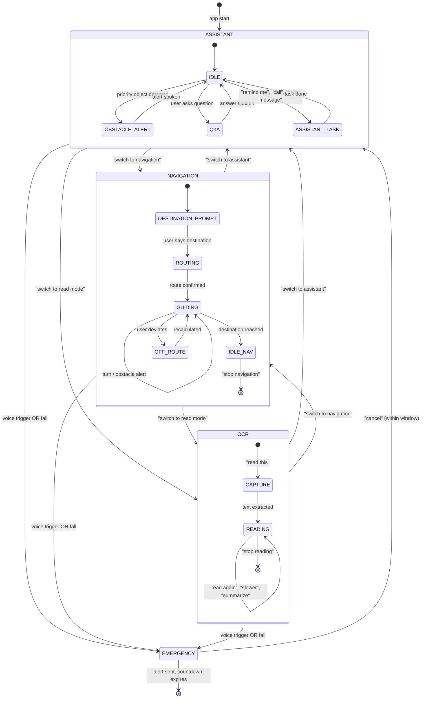
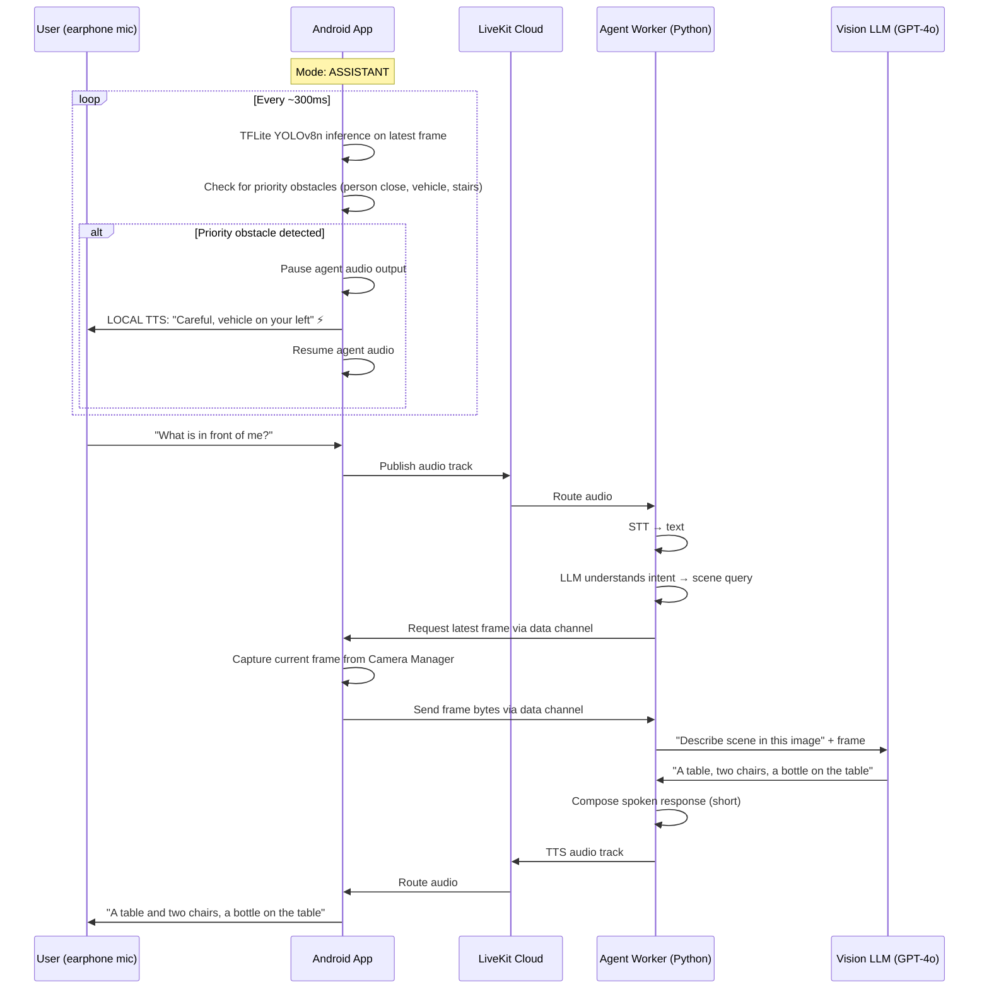
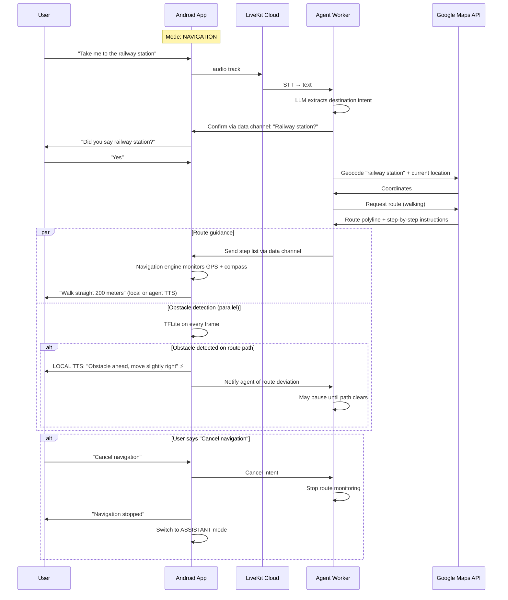
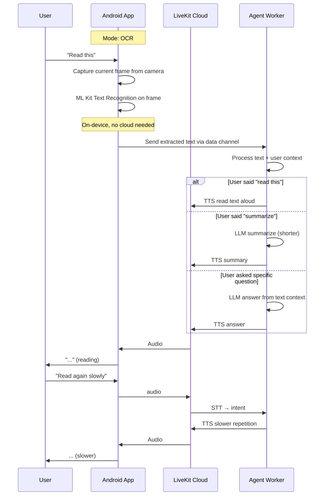

# Drishti — Architecture & Build Plan (Mobile-First)

> **Build target:** Android-native (Kotlin) app + LiveKit voice agent + vision pipeline + ESP32-CAM / phone camera  
> **Source documents:** `PRD_Drishti v3 (Final).md`, `One-Shot-Build-Spec.md`, base repo at `livekit-frontend-with-backend-for-use-anywhere-/`

---

## 0. Mission Statement

Drishti is a voice-only AI companion for visually impaired users. It runs on an Android phone, worn with an earphone+mic, and provides three modes switched entirely by voice:

- **Assistive Voice Agent** — obstacle detection, scene Q&A, personal assistant, emergency alerts  
- **Navigation** — turn-by-turn guidance with camera-aided obstacle spotting  
- **OCR / Reading** — reads text from camera frames (signs, labels, currency, menus)

The phone connects to an ESP32-CAM over Wi-Fi (MJPEG stream), or uses its own camera as fallback. All control is by voice; no screen touch is required.

### Tech Stack

| Layer | Choice | Version |
|---|---|---|
| Mobile app | **Kotlin** (Android native) | minSdk 26, targetSdk 34 |
| LiveKit SDK | `livekit-android` | latest stable |
| Token server | **FastAPI** (reuse `main.py`) | Python 3.11 |
| Agent worker | **Python** + `livekit-agents` | ≥ 1.0.0 |
| STT → LLM → TTS | LiveKit plugins: **OpenAI GPT-4o / Gemini 2.0 Flash** + **Sarvam/Silero** | — |
| Vision (on-device) | **YOLOv8n → TFLite** (TensorFlow Lite) | AGPL-3.0 |
| Vision (cloud) | **GPT-4o vision** or **Gemini Vision Pro** | via LLM |
| Maps | **Google Maps SDK** + **Maps Routes API** | latest |
| Camera stream | ESP32-CAM **MJPEG over HTTP** + phone camera | — |
| Emergency | **Android SMS** + **WhatsApp Intent** + **Firebase Cloud Messaging** | — |

### Build rule

> Build everything listed in Sections 0–6 first (mission, structure, config, schema, deps, core components). Sections 7–12 are sequenced on top. Do not skip, simplify, or substitute libraries without a documented reason.

---

## 1. Deviations from the PRD

Every change from `PRD_Drishti v3 (Final).md` with a reason:

| PRD statement | New direction | Reason |
|---|---|---|
| Laptop is the brain; ESP32 → laptop → audio | **Phone is the brain** (Android app) | The user requested a "direct mobile app" — no laptop needed. The phone has a CPU, GPU (via TFLite NNAPI), camera, GPS, cellular radio. |
| Physical push-button primary, voice secondary | **Voice-only** mode switching | Blind user controls everything via earphone mic. No physical button to reach for. |
| LiveKit is a "gated stretch layer" | **LiveKit is core** (always on) | The new design is a real-time voice agent. Without LiveKit there is no conversational UX. |
| OCR explicitly **out of scope** | **Mode 3: OCR / Reading** is now in scope | The user specified three modes (Assistant, Navigation, OCR). OCR is mandatory. |
| ESP32-CAM + laptop webcam as sources | **ESP32-CAM Wi-Fi + phone camera** as switchable sources | Phone camera is always available; ESP32-CAM can be mounted on a chest strap for wider FOV. |
| `face_recognition`/dlib (Python, local) | **On-device TFLite + ML Kit** for face detection+recognition | dlib does not run on Android. ML Kit + MobileFaceNet TFLite model is the Android-native path. |
| `pyttsx3`/`gTTS` for local TTS | **Android TextToSpeech (on-device)** or **LiveKit TTS** | For offline fallback. Android's built-in TTS is zero-latency and needs no API key. |
| Hackathon MVP → Phase 2 mobile → Phase 3 pilot | **Directly build the mobile prototype** (skipping the laptop phase) | The user is building the app now. The laptop intermediate step is eliminated. |

---

## 2. Architecture Overview

```mermaid
flowchart TB
    subgraph Hardware
        ESP[ESP32-CAM\nMJPEG stream over WiFi]
        PHONE_CAM[Phone Camera\nfallback source]
        MIC[Earphone Mic\nuser's voice]
        SPEAKER[Earphone Speaker\nagent's voice]
        GPS[(GPS / Accelerometer\nphone sensors)]
    end

    subgraph Android App (Kotlin)
        CM[Camera Manager\nESP32 ↔ Phone switch]
        LK_CLIENT[LiveKit Room Client\naudio tracks in/out]
        MM[Mode Manager\nstate machine / voice intent]
        VM_CPU[Vision Pipeline (TFLite)\nYOLOv8n obstacle detection\nface detection / OCR]
        EM[Emergency Monitor\nfall detection, voice trigger]
        NAV_ENG[Navigation Engine\nGoogle Maps + heading]
    end

    subgraph Cloud Services
        LK_SRV[LiveKit Cloud\nWebRTC routing]
        TS[Token Server\nFastAPI JWT issuer]
        AGENT[Agent Worker\nSTT→LLM→TTS + vision-LLM]
        LLM_VISION[Vision LLM\nGPT-4o / Gemini Vision]
        MAPS[Google Maps API\nroutes + geocoding]
    end

    ESP -->|HTTP MJPEG| CM
    PHONE_CAM -->|CameraX| CM
    CM -->|video track| LK_CLIENT
    MIC -->|audio track| LK_CLIENT
    LK_CLIENT -->|audio out| SPEAKER
    LK_CLIENT --> LK_SRV

    LK_SRV -->|audio in| AGENT
    AGENT -->|audio out| LK_SRV
    AGENT --> LLM_VISION
    AGENT --> MAPS
    TS -->|JWT| LK_CLIENT

    CM -->|frames| VM_CPU
    VM_CPU -->|obstacle alerts| MM
    GPS -->|location| NAV_ENG
    MM -->|mode state| AGENT
    MM -->|mode state| VM_CPU

    EM -->|alert trigger| MM

    linkStyle default stroke-width:2px
```

### Layered view

| Layer | Responsibility |
|---|---|
| **Hardware** | ESP32-CAM, phone sensors, earphone — I/O |
| **App (Kotlin)** | Camera switching, LiveKit connection, TFLite vision, mode management, navigation engine, emergency monitor |
| **Cloud (LiveKit + Agent)** | Voice pipeline (STT→LLM→TTS), vision LLM queries, map route calculation |
| **Services** | Google Maps API, token server (FastAPI) |

---

## 3. Component Table

| Component | Responsibility | Technology | Build / Reuse / Buy |
|---|---|---|---|
| **Android App** | UI-less foreground service + voice control + camera mgmt | **Kotlin** + Android SDK | **Build** (~2 weeks) |
| **LiveKit Room Client** | Audio track publish/subscribe, video track (camera) publish | `livekit-android` SDK | **Reuse** (SDK) |
| **Camera Manager** | ESP32-CAM MJPEG stream → `Surface` → video track; fallback to CameraX | Kotlin coroutines + `libvpx` encoding | **Build** |
| **Mode Manager** | State machine: ASSISTANT ↔ NAVIGATION ↔ OCR ↔ EMERGENCY; voice-intent routing | Kotlin sealed class + LiveKit data channel | **Build** |
| **Vision Pipeline (on-device)** | YOLOv8n TFLite → bounding boxes → obstacle classification + position | TensorFlow Lite + NNAPI delegate | **Reuse** (model) + **Build** (wrapper) |
| **Face Detection** | Locate faces in frame (for privacy: no storage) | Google ML Kit face detection | **Reuse** (SDK) |
| **OCR Engine** | Text extraction from camera frame | Google ML Kit text recognition (on-device) | **Reuse** (SDK) |
| **Navigation Engine** | GPS + compass heading + route overlay + obstacle-aware guidance | Google Maps SDK + Routes API | **Reuse** (SDK + API) |
| **Emergency Monitor** | Fall detection (accelerometer), voice trigger "Help emergency", inactivity timer | Android SensorManager + Kotlin | **Build** |
| **Token Server** | Issue LiveKit JWT tokens | FastAPI (reuse `main.py` from base repo) | **Reuse** (exact copy, deploy) |
| **Agent Worker** | STT→LLM→TTS pipeline; vision-LLM calls; mode-aware behavior | Python + `livekit-agents` + `openai` / `google-genai` | **Build** (new agent) |
| **ESP32-CAM Firmware** | Stream MJPEG over HTTP (station mode), auto-connect to configured SSID | Arduino / ESP-IDF (CameraWebServer variant) | **Reuse** (stock example + minor config) |
| **Google Maps API** | Geocoding, routing, turn-by-turn instructions | Google Cloud API (paid) | **Buy** |
| **SMS/WhatsApp Alerting** | Send emergency alert with location + snapshot | Android `SmsManager` + WhatsApp Intent | **Reuse** (platform APIs) |
| **Offline Obstacle Fallback** | YOLOv8n on-device, local TTS via `android.speech.tts` | TFLite + Android TTS | **Build** (same pipeline, no cloud) |

---

## 4. Mode Manager Design

### States & Transitions



### Voice Intent Routing (shared logic)

Every user utterance flows through an **Intent Router** before reaching the mode-specific handler:

1. **Reserved commands** (check first, always apply):
   - `"switch to <mode>"` → Mode switch (with confirmation)
   - `"which mode am I in"` → Announce current mode
   - `"switch mode"` (ambiguous) → Ask which one
   - `"help emergency"` / `"help"` → Enter EMERGENCY state
   - `"cancel"` → Cancel pending emergency countdown

2. **Mode-specific intents** (routed by current mode):
   - ASSISTANT: Q&A, reminders, calls, describe scene, check path
   - NAVIGATION: set destination, route queries, "how far", "cancel nav"
   - OCR: "read this", "read again", "summarize", "slower"

3. **Priority override** (interrupts any mode):
   - Obstacle alerts from the TFLite vision pipeline interrupt the agent mid-sentence via LiveKit's `source.capture_audio` pause/resume mechanism or by injecting a higher-priority audio frame.

### Shared Services (accessed by all modes)

| Service | Function | Accessed by |
|---|---|---|
| Camera Manager | Provides latest frame + frame rate status | All modes |
| LiveKit Room | Audio in/out, video track publish | All modes |
| TFLite Pipeline | Object detection, obstacle classification | ASSISTANT, NAVIGATION |
| ML Kit OCR | Text extraction from bitmap | OCR |
| Location Service | GPS + compass heading | NAVIGATION, EMERGENCY |
| Emergency Monitor | Fall detection, inactivity checks | All modes (always on) |
| Contact Store | Emergency contacts, known contacts | EMERGENCY, ASSISTANT (calls) |
| Preferences | Saved settings (WiFi ESP32, contacts, TTS speed) | All modes |

---

## 5. Data & Media Flow per Mode

### Mode 1 — Assistive Voice Agent (sequence)



### Mode 2 — Navigation (sequence)



### Mode 3 — OCR / Reading (sequence)



---

## 6. Camera Connectivity Design

### ESP32-CAM → Android App

```
┌──────────┐     HTTP MJPEG      ┌──────────────────┐
│ ESP32-CAM │  ─────────────────→ │ Android App      │
│           │  ws://192.168.x.x   │ Camera Manager   │
│           │  /stream            │                  │
│ WIFI STA  │                    │ Decode frames    │
│ mode      │                    │ → Bitmap         │
└──────────┘                    → Compress to VP8   │
                                 → Publish as       │
                                   LiveKit video    │
                                   track            │
                                 └──────────────────┘
```

### Connection flow

1. App connects to ESP32-CAM via HTTP on its known IP (saved from provisioning).
2. App polls `http://esp32-ip/stream` — reads multipart JPEG boundary stream.
3. Each frame is decoded to a `Bitmap` and fed to:
   - **TFLite vision pipeline** (YOLOv8n) for obstacle detection
   - **LiveKit video track** for transmission to the agent (vision-LLM)
4. If the stream drops (Wi-Fi disconnect), the app:
   - Announces "Camera lost, switching to phone camera"
   - Starts the phone camera via CameraX
   - Retries ESP32 connection in the background every 5 seconds
   - When reconnected, announces "Camera reconnected" and switches back (or stays on phone camera — user can say "use ESP32 camera")

### Latency budget

| Segment | Target | Worst-case |
|---|---|---|
| ESP32 frame capture | 100 ms | 200 ms |
| MJPEG decode | 20 ms | 50 ms |
| TFLite inference (YOLOv8n) | 150 ms | 300 ms |
| Obstacle alert TTS (local) | 100 ms | 200 ms |
| **Total obstacle → alert** | **~370 ms** | **~750 ms** |
| Frame → LiveKit video track | 200 ms | 400 ms |
| Video track → Agent | LiveKit latency (~100 ms) | ~300 ms |
| Agent sends to vision LLM | 800-1500 ms | 3000 ms |
| **Total scene Q&A latency** | **~1.5-2 s** | **~4 s** |

### Reconnect & fallback strategy

```
stateDiagram-v2
    [*] --> ESP32_CONNECTED
    ESP32_CONNECTED --> ESP32_LOST : stream timeout (3s no frame)
    ESP32_LOST --> PHONE_CAMERA_ACTIVE : switch announcement
    PHONE_CAMERA_ACTIVE --> ESP32_RETRYING : background retry every 5s
    ESP32_RETRYING --> ESP32_CONNECTED : success → announcement
    ESP32_RETRYING --> PHONE_CAMERA_ACTIVE : max retries exceeded → stop
    PHONE_CAMERA_ACTIVE --> [*] : user stays on phone camera
```

### ESP32 Provisioning

- **First-time setup:** App creates a Wi-Fi SoftAP (or uses BLE), sends SSID + password to the ESP32.
- ESP32 stores credentials in NVS, reboots in STA (station) mode.
- App remembers the assigned IP.
- Subsequent launches: direct connect.

---

## 7. Emergency Alert Design

### Trigger logic

| Trigger | Detection | Action |
|---|---|---|
| Voice phrase | `"Help, emergency!"` → LiveKit STT matches pattern | Start countdown |
| Fall detection | Phone accelerometer → ML Kit activity recognition: `STILL` after `RUNNING`/`WALKING` with impact | Ask "Are you okay?" + 15s window |
| Long inactivity | No voice activity for 60 min AND no GPS movement for 10 min | Escalate slowly: ask → 30s → alert |

### Cancel window

```
Trigger ──→ "Alert in 10 seconds, say cancel to stop" 
               │
               ├── "Cancel" ──→ "Alert cancelled" ──→ Normal mode
               │
               10 seconds later ──→ ALERT FIRES
```

- Voice: 10-second countdown with speech confirmation every 2 seconds
- Fall: 15-second countdown after "Are you okay?", repeats every 5 seconds
- Inactivity: 30-second countdown, one confirmation

### Alert payload

```
{
  "user_name": "User's name (from profile)",
  "location": {
    "lat": 28.6129,
    "lng": 77.2295,
    "accuracy_m": 15,
    "address": "Connaught Place, New Delhi"
  },
  "photo_snapshot": "base64_jpeg_or_url (uploaded to tmp storage)",
  "timestamp": "2025-03-29T14:30:00+05:30",
  "mode_at_time": "ASSISTANT",
  "trigger": "voice_emergency | fall_detected | inactivity"
}
```

### Notification channels (tried in order)

1. **SMS** — via `SmsManager.sendTextMessage()` to each emergency contact. Includes a Google Maps link.
2. **WhatsApp** — via `Intent.ACTION_SEND` with `text/plain` to each contact's phone number.
3. **Call** — via `Intent.ACTION_CALL` (auto-dial) to primary contact, plays a pre-recorded message using Android's TextToSpeech during the call (or an audio file).

### Failure fallback

| Failure scenario | Action |
|---|---|
| No cellular signal | Local siren (phone speaker at max volume), flash camera LED, and store alert for retry |
| WhatsApp not installed | Skip to SMS |
| SMS fails | Try WhatsApp, then call |
| All channels fail | Local siren + store alert + retry every 60 seconds |

### Privacy

- Photo snapshot is **not stored on disk** — captured from the camera buffer, used only for the alert, discarded after.
- Location is requested from `FusedLocationProviderClient` single-shot, not persistent tracking (except in Navigation mode where the user explicitly consents).
- Emergency contacts are stored on-device only.

---

## 8. Model Strategy

### Routing rule

```
User utterance + frame (if available)
            │
            ▼
     ┌─────────────┐
     │ Intent Classifier │ ← lightweight (on-device or agent-side)
     └──────┬──────┘
            │
    ┌───────┴────────┐
    ▼                ▼
Simple task         Complex task
(latency-critical)  (accuracy-critical)
    │                    │
    ▼                    ▼
On-device TFLite     Cloud Vision LLM
YOLOv8n obstacle      GPT-4o / Gemini
ML Kit OCR           Scene Q&A
Android TTS          Summarization
                      Route planning
```

### Model inventory

| Task | Model | Where it runs | Latency target | When used |
|---|---|---|---|---|
| Object/obstacle detection | YOLOv8n → TFLite (COCO) | On-device (TFLite + NNAPI) | < 200 ms per frame | Always (background) |
| Face detection | Google ML Kit Face Detection | On-device | < 100 ms | ASSISTANT mode |
| Face recognition | MobileFaceNet TFLite embedding + cosine similarity | On-device | < 150 ms | ASSISTANT (known people) |
| OCR (text extraction) | Google ML Kit Text Recognition | On-device | < 200 ms | OCR mode |
| Fall detection | ML Kit Activity Recognition + custom heuristic | On-device | < 500 ms | Always (background) |
| Voice → text (STT) | LiveKit plugin (OpenAI / Sarvam / Azure) | Cloud (agent) | < 600 ms | All modes |
| Intent classification | OpenAI GPT-4o mini (prompt-based) | Cloud (agent) | < 400 ms | Each utterance |
| Scene Q&A | GPT-4o vision / Gemini Vision Pro | Cloud (agent) | 1-2 s | ASSISTANT mode "what do you see?" |
| Route + navigation | Google Maps Routes API | Cloud (maps API) | < 1 s | NAVIGATION mode |
| Text → speech (TTS) | LiveKit plugin (Sarvam / Silero / OpenAI) | Cloud (agent) | 400-800 ms | All modes |
| **Fallback TTS** (offline) | Android TextToSpeech engine | On-device | < 200 ms | Obstacle alerts, emergency |

### Latency target per mode

| Mode | Obstacle alert latency (local pipeline) | Q&A response latency (cloud pipeline) |
|---|---|---|
| ASSISTANT | < 500 ms (priority alert via local TTS) | 1.5 - 3 s |
| NAVIGATION | < 500 ms + turns announced at waypoint | Route calc: < 2 s |
| OCR | N/A (on-device text extraction) | < 1 s for "summarize" (cloud), < 100 ms for raw read (local) |

### Model loading strategy

- YOLOv8n TFLite model is loaded at app startup and kept in memory.
- ML Kit models are lazy-loaded per mode (face detection on ASSISTANT enter, OCR on OCR enter).
- Cloud models are never cached — they are stateless API calls.

---

## 9. Mobile App Choice & Justification

### Choice: **Kotlin / Android Native** (not Flutter, not React Native)

| Criterion | Kotlin Native | Flutter | React Native |
|---|---|---|---|
| LiveKit SDK support | ✅ `livekit-android` (first-party, maintained) | ✅ `livekit-flutter` (community) | ⚠️ `livekit-react-native` (community, lagging) |
| TFLite / NNAPI | ✅ First-class `tflite-support`, NNAPI delegate | ⚠️ `tflite_flutter` (binding layer, slower) | ⚠️ JNI bridge needed |
| CameraX / Camera2 | ✅ Direct access (CameraX is Android Jetpack) | ⚠️ `camera` plugin (limited) | ⚠️ `react-native-camera-kit` |
| Background service | ✅ Foreground Service + MediaSession | ⚠️ `flutter_background_service` (workaround) | ⚠️ `react-native-background-actions` |
| GPS / SensorManager | ✅ Direct Android API | ✅ via plugins | ✅ via plugins |
| ESP32 MJPEG decode | ✅ `OkHttp` + `BitmapFactory` directly | ⚠️ need platform channel | ⚠️ need native module |
| Emergency SMS / WhatsApp | ✅ `SmsManager` + Intent (native APIs) | ⚠️ platform channel needed | ⚠️ native module needed |
| Accessibility (TalkBack override) | ✅ Full control via `AudioManager`, `AccessibilityService` | ⚠️ limited | ⚠️ limited |
| Build complexity | Medium (one platform, one language) | Low (cross-platform) | Low (cross-platform) |

**Verdict:** Kotlin native wins on camera control, TFLite acceleration (NNAPI delegate via Android-specific C API), background service reliability, and platform API access — all critical for a vision + voice app that runs as a foreground service. Flutter adds a JNI bridge for every native operation, and React Native loses on LiveKit support and performance.

### Background / Foreground service handling

- **Foreground Service** with `NOTIFICATION_TYPE_SERVICE` keeps the app alive even when the screen is off.
- **MediaSession** callback mode — the app registers as a media app; the earphone button triggers "Hey Drishti" / resume.
- **Wake lock** is acquired only when the camera is active; released during pure-voice interactions (Assistant Q&A without vision).
- **Battery optimization** is whitelisted via `ACTION_REQUEST_IGNORE_BATTERY_OPTIMIZATIONS` on first launch.

---

## 10. Folder Structure (Monorepo)

```
drishti/
├── android/                          # 📱 Android app (Kotlin)
│   ├── app/
│   │   ├── src/main/java/ai/drishti/
│   │   │   ├── MainActivity.kt           # Entry point, permission requests
│   │   │   ├── DrishtiService.kt          # Foreground service (always-on)
│   │   │   ├── audio/
│   │   │   │   ├── LiveKitClient.kt       # Room connection + track management
│   │   │   │   └── LocalTTS.kt            # Android TTS for offline fallback
│   │   │   ├── camera/
│   │   │   │   ├── CameraManager.kt       # Manages ESP32 + phone camera switching
│   │   │   │   ├── Esp32StreamClient.kt   # HTTP MJPEG client for ESP32-CAM
│   │   │   │   └── PhoneCamera.kt         # CameraX integration
│   │   │   ├── vision/
│   │   │   │   ├── TFLiteDetector.kt      # YOLOv8n TFLite wrapper
│   │   │   │   ├── ObstacleClassifier.kt  # Proximity + position from boxes
│   │   │   │   ├── FaceDetector.kt        # ML Kit face detection
│   │   │   │   └── OcrEngine.kt           # ML Kit text recognition
│   │   │   ├── navigation/
│   │   │   │   ├── NavigationEngine.kt    # GPS + route + turn guidance
│   │   │   │   └── NavStateManager.kt     # Waypoint progression
│   │   │   ├── mode/
│   │   │   │   ├── ModeManager.kt         # State machine (sealed class)
│   │   │   │   ├── VoiceIntentRouter.kt   # Reserved vs mode-specific intents
│   │   │   │   └── ModeConfig.kt          # Mode-specific settings
│   │   │   ├── emergency/
│   │   │   │   ├── EmergencyMonitor.kt    # Fall detection, inactivity, voice trigger
│   │   │   │   ├── AlertSender.kt         # SMS + WhatsApp + call dispatch
│   │   │   │   └── ContactStore.kt        # On-device encrypted contact storage
│   │   │   ├── sensors/
│   │   │   │   ├── LocationProvider.kt    # FusedLocationProviderClient wrapper
│   │   │   │   └── FallDetector.kt        # Accelerometer-based fall heuristic
│   │   │   └── utils/
│   │   │       ├── PreferenceManager.kt   # DataStore for settings
│   │   │       └── WifiProvisioner.kt     # ESP32 provisioning (BLE/SoftAP)
│   │   └── src/main/res/                  # Layouts, drawables, raw (models)
│   ├── build.gradle.kts
│   └── settings.gradle.kts
│
├── agent/                            # 🔧 LiveKit Agent Worker (Python)
│   ├── drishti_agent.py                  # Main agent entrypoint + mode-aware behavior
│   ├── requirements.txt
│   └── .env.example
│
├── token-server/                     # 🔐 FastAPI token server
│   ├── main.py                           # Reused from base repo (GET /token)
│   ├── requirements.txt
│   └── .env.example
│
├── esp32-firmware/                   # 🔌 ESP32-CAM firmware
│   ├── mjpeg_streamer/
│   │   ├── mjpeg_streamer.ino             # Arduino sketch (CameraWebServer variant)
│   │   └── config.h                        # GPIO pin definitions, ESP32-CAM model
│   └── README.md
│
├── docs/
│   ├── architecture_overview.md
│   ├── mode_manager_design.md
│   └── emergency_alert_flow.md
│
├── assets/
│   ├── models/
│   │   ├── yolov8n_float32.tflite         # YOLOv8n converted to TFLite (full precision)
│   │   ├── yolov8n_float16.tflite         # YOLOv8n quantized to float16
│   │   └── mobilenet_face_embedding.tflite # Face recognition embedding model
│   └── labels/
│       └── coco_labels.txt                # 80 COCO class names
│
├── README.md
└── .gitignore
```

### One-line responsibilities (every file that will exist)

| File | Responsibility |
|---|---|
| `android/.../MainActivity.kt` | Request permissions, start foreground service |
| `android/.../DrishtiService.kt` | Foreground service: manages lifecycle, camera, LiveKit, sensors |
| `android/.../LiveKitClient.kt` | Connect/disconnect LiveKit room, publish audio/video, subscribe agent audio |
| `android/.../LocalTTS.kt` | Android TTS for offline obstacle alerts and emergency announcements |
| `android/.../CameraManager.kt` | Switch between ESP32-CAM and phone camera; provide latest frame |
| `android/.../Esp32StreamClient.kt` | HTTP MJPEG reader: connect, poll, decode JPEG frames from ESP32 |
| `android/.../PhoneCamera.kt` | CameraX: open, bind to SurfaceProvider, produce frames |
| `android/.../TFLiteDetector.kt` | Load TFLite model, run inference on bitmap, return detected objects |
| `android/.../ObstacleClassifier.kt` | Filter COCO classes to obstacles, compute proximity from box size |
| `android/.../FaceDetector.kt` | ML Kit face detection: locate faces in frame |
| `android/.../OcrEngine.kt` | ML Kit text recognition: extract text from bitmap |
| `android/.../NavigationEngine.kt` | GPS + Maps API route: compute bearing, announce turns |
| `android/.../NavStateManager.kt` | Track waypoint progression, detect off-route deviation |
| `android/.../ModeManager.kt` | Sealed-class state machine; transitions with spoken confirmation |
| `android/.../VoiceIntentRouter.kt` | Classify user utterance as reserved command vs. mode-specific intent |
| `android/.../ModeConfig.kt` | Per-mode settings (TTS speed, retry intervals, etc.) |
| `android/.../EmergencyMonitor.kt` | Listen for fall, inactivity, voice "help"; trigger countdown |
| `android/.../AlertSender.kt` | Dispatch SMS → WhatsApp → call with location + photo |
| `android/.../ContactStore.kt` | Encrypted SharedPreferences for emergency contacts |
| `android/.../LocationProvider.kt` | FusedLocationProviderClient: last known + continuous updates |
| `android/.../FallDetector.kt` | Accelerometer heuristics: impact + stationary post-impact |
| `android/.../PreferenceManager.kt` | DataStore: ESP32 IP, contacts, TTS speed, mode defaults |
| `android/.../WifiProvisioner.kt` | BLE/SoftAP provisioning of SSID/password to ESP32 |
| `agent/drishti_agent.py` | LiveKit agent: mode-aware STT→LLM→TTS pipeline + vision-LLM calls |
| `token-server/main.py` | FastAPI: GET /token → signed LiveKit JWT (reused from base repo) |
| `esp32-firmware/mjpeg_streamer/mjpeg_streamer.ino` | Modified CameraWebServer for reliable MJPEG streaming |
| `assets/models/yolov8n_float16.tflite` | Quantized YOLOv8n for on-device inference |
| `assets/labels/coco_labels.txt` | COCO class names printed as text per detection |

---

## 11. Minimum-Code Plan (What to implement vs. what to configure)

### Already exists in base repo (reuse with zero changes)

| Component | File | Action |
|---|---|---|
| **Token server** | `main.py` (FastAPI) | Copy to `token-server/main.py`. Works as-is. |
| **LiveKit agent pattern** | `scheme_awareness_agent.py` | Reference for how to write `drishti_agent.py` — the `AgentSession` + `entrypoint` pattern is correct. |

### Need to build (new custom code)

| Priority | File | Effort |
|---|---|---|
| 🥇 | `android/.../DrishtiService.kt` (foreground service shell) | ~3 hours |
| 🥇 | `android/.../ModeManager.kt` (sealed class state machine) | ~2 hours |
| 🥇 | `android/.../VoiceIntentRouter.kt` (intent classification) | ~1 hour |
| 🥇 | `android/.../CameraManager.kt` (switch ESP32 ↔ phone) | ~3 hours |
| 🥇 | `android/.../Esp32StreamClient.kt` (MJPEG reader) | ~2 hours |
| 🥇 | `android/.../LiveKitClient.kt` (room + tracks) | ~2 hours |
| 🥇 | `android/.../TFLiteDetector.kt` (YOLO wrapper) | ~2 hours |
| 🥇 | `android/.../ObstacleClassifier.kt` | ~1 hour |
| 🥇 | `android/.../LocalTTS.kt` (Android TTS) | ~1 hour |
| 🥇 | `agent/drishti_agent.py` (new agent worker) | ~4 hours |
| 🥈 | `android/.../OcrEngine.kt` | ~1 hour |
| 🥈 | `android/.../NavigationEngine.kt` | ~4 hours |
| 🥈 | `android/.../EmergencyMonitor.kt` | ~2 hours |
| 🥈 | `android/.../AlertSender.kt` | ~2 hours |
| 🥉 | `android/.../PhoneCamera.kt` (CameraX) | ~2 hours |
| 🥉 | `android/.../FaceDetector.kt` | ~1 hour |
| 🥉 | `android/.../FallDetector.kt` | ~1 hour |
| 🥉 | `android/.../ContactStore.kt` | ~1 hour |
| 🥉 | `android/.../WifiProvisioner.kt` | ~2 hours |

### Configuration only (no code to write)

| What | Details |
|---|---|
| `agent/.env.example` | `LIVEKIT_URL=wss://...` `LIVEKIT_API_KEY=...` `LIVEKIT_API_SECRET=...` `OPENAI_API_KEY=...` `SARVAM_API_KEY=...` `GOOGLE_MAPS_API_KEY=...` |
| `token-server/.env.example` | `LIVEKIT_API_KEY=...` `LIVEKIT_API_SECRET=...` |
| `android/.../build.gradle.kts` | Add dependencies: `livekit-android`, `tensorflow-lite`, `tensorflow-lite-support`, `mlkit-text-recognition`, `mlkit-face-detection`, `google-maps`, `kotlinx-coroutines`, `okhttp3` (for MJPEG), `datastore-preferences` |
| ESP32-CAM `config.h` | Define `ESP32CAM_MODEL`, `PWDN_GPIO_NUM`, `RESET_GPIO_NUM`, etc. |
| YOLOv8n → TFLite export | Run `yolo export model=yolov8n.pt format=tflite` once. Save to `assets/models/`. |

### SDKs / libraries (no custom implementation)

| Need | SDK |
|---|---|
| Text-to-speech (offline) | `android.speech.tts.TextToSpeech` (Android built-in) |
| Face detection | Google ML Kit `com.google.mlkit:face-detection` |
| Text recognition / OCR | Google ML Kit `com.google.mlkit:text-recognition` |
| Activity recognition (fall) | `com.google.android.gms:play-services-location` (ActivityRecognitionClient) |
| Maps + routes | Google Maps SDK + Routes API (REST) |
| LiveKit room | `io.livekit:livekit-android` |
| TFLite inference | `org.tensorflow:tensorflow-lite` + `tensorflow-lite-support` |
| ESP32 HTTP streaming | `OkHttp` (square) |
| SMS sending | `android.telephony.SmsManager` (Android built-in) |
| Coroutines / async | `org.jetbrains.kotlinx:kotlinx-coroutines-android` |

### Agent worker reference snippet (interface, not full implementation)

```python
# drishti_agent.py — Minimal skeleton to show the pattern
import os
from livekit.agents import JobContext, WorkerOptions, cli, RoomInputOptions
from livekit.agents.voice import Agent, AgentSession
from livekit.plugins import openai, sarvam, google
from dotenv import load_dotenv

load_dotenv()

class DrishtiAgent(Agent):
    def __init__(self, mode: str = "assistant"):
        self._mode = mode
        super().__init__(
            instructions=self._build_prompt(mode),
            stt=sarvam.STT(language="unknown", model="saaras:v3", mode="transcribe"),
            llm=openai.LLM(model="gpt-4o"),
            tts=sarvam.TTS(target_language_code="hi-IN", model="bulbul:v3", speaker="kabir"),
        )

    def _build_prompt(self, mode: str) -> str:
        prompts = {
            "assistant": "You are Drishti, a voice companion for visually impaired users...",
            "navigation": "You are a navigation guide...",
            "ocr": "You read text from images...",
        }
        return prompts.get(mode, prompts["assistant"])

    async def on_enter(self):
        await self.session.generate_reply()

async def entrypoint(ctx: JobContext):
    await ctx.connect()
    session = AgentSession()
    await session.start(
        agent=DrishtiAgent(),
        room=ctx.room,
        room_input_options=RoomInputOptions(),
    )

if __name__ == "__main__":
    cli.run_app(WorkerOptions(entrypoint_fnc=entrypoint))
```

---

## 12. Phased Roadmap

### Phase 1 — MVP (1 week)

**Goal:** A working voice agent with basic obstacle detection and mode switching.

| Day | Deliverable | "Done" test |
|---|---|---|
| 1-2 | Kotlin project skeleton + Foreground Service shell + LiveKitClient | App starts, shows notification, connects to LiveKit room, publishes audio |
| 2-3 | Token server (copy `main.py`), Agent worker skeleton (basic STT→LLM→TTS) | User speaks into phone → agent speaks back (any answer) |
| 3-4 | Camera Manager + Esp32StreamClient + PhoneCamera + TFLiteDetector | App receives camera frames, YOLO detects a person/chair in view |
| 4-5 | ObstacleClassifier + LocalTTS (offline alerts) + ModeManager (ASSISTANT + NAV) | Obstacle triggers local TTS alert. Voice "switch to navigation" switches mode |
| 5-6 | NavigationEngine (GPS + turn announcements) + Google Maps route | "Take me to X" → route computed → turn turns announced |
| 6-7 | EmergencyMonitor (voice trigger) + AlertSender (SMS) + FallDetector (basic) | Say "help emergency" → countdown → SMS sent to test contact |

**Done:** End-to-end on a real phone, user wears earphone, says "what is in front of me", gets answer, says "switch mode", it works.

### Phase 2 — v1 (week 2-3)

| Feature | Detail |
|---|---|
| OCR mode (Mode 3) | ML Kit text recognition + "read again", "summarize", Hindi support |
| Vision-LLM scene Q&A | Send frame to agent → LLM describes scene |
| ESP32 provisioning UI | BLE provisioning flow (first-time setup) |
| Face detection + recognition | "Is someone I know here?" – ML Kit + MobileFaceNet |
| Voice intent router improvements | Hinglish support, ambiguous command handling |
| Emergency improvements | WhatsApp channel, photo snapshot, inactivity detection |
| Offline fallback | YOLO + Android TTS works without internet |
| Battery optimization | Wake lock management, camera release |

### Phase 3 — v2 (week 4+)

| Feature | Detail |
|---|---|
| Real user testing | 3-5 visually impaired users, structured feedback |
| False positive/negative tuning | Obstacle classifier calibration, cooldown logic |
| Production hardening | Error handling, reconnection, crash analytics |
| Privacy audit | Camera data, face data, location data handling |
| Google Play Store | Accessibility app listing, permissions review |
| Accessibility Service | Earphone button "Hey Drishti" hotword detection |

---

## 13. Risks & Open Questions

| Risk | Impact | Mitigation |
|---|---|---|
| **ESP32-CAM Wi-Fi latency** — WiFi adds 100-300ms frame delay | Obstacle alerts could lag | Use phone camera as default; ESP32 is optional. Start with phone camera in MVP. |
| **Phone battery drain** — Camera + TFLite + LiveKit + GPS simultaneously | Could drain 50% per hour | Aggressive wake lock management; only run TFLite at 5fps instead of 30fps; use NNAPI delegate for GPU offload |
| **Wi-Fi dropping while user walks** — ESP32 loses connection when phone moves away from user's hotspot | Camera feed lost | Phone-as-hotspot is the fallback; auto-switch to phone camera on drop |
| **LiveKit latency in India** — Cloud servers may be far from user | Voice agent 3-5s response time | Deploy agent worker on a nearby cloud region (Mumbai); use `silero` TTS for lower latency |
| **Offline obstacle detection accuracy** — YOLOv8n on phone CPU vs laptop GPU | Lower FPS, fewer detections | Quantize to float16, use NNAPI, reduce input resolution (320x320 instead of 640x640) |
| **Privacy — camera sending to cloud LLM** — User's home/location goes through GPT-4o/Gemini | User trust, data handling | Use OpenAI's "no training" data policy; encrypt frame bytes; offer Gemini as alternative with its own data policy; allow user to disable cloud vision |
| **Safety disclaimer** — User trusts the system and ignores their cane/guide dog | Legal risk, user safety | Every startup prompt says: "Drishti is an assistive aid, not a replacement for a cane, guide dog, or human guide. Always use your primary mobility aid." |

### Open questions

1. **What walking speed does the user typically move at?** This affects the TFLite frame rate requirement (faster walking = higher fps needed for obstacle detection). Default: assume 1.2 m/s (typical human walking pace), tune from user testing.

2. **Should the ESP32-CAM use the phone's Wi-Fi hotspot directly, or a separate router?** If the phone acts as a hotspot, the ESP32 streams to itself — this works but adds latency. If a separate portable router (e.g. a travel router clipped to a belt), the phone and ESP32 are on the same LAN without the phone being the router. **Default: phone hotspot for MVP** (simplest), separate router for v1.

3. **Hindi + Hinglish OCR** — ML Kit's `TextRecognition` supports Latin and Devanagari scripts. The agent will need to handle both. Should the user be able to say "English mein padho" or "Hindi mein padho" to switch OCR language? **Default: auto-detect script from the frame, read in that language.**

---

## 14. Cost Reference

| Service | SKU / Pricing | Estimated monthly cost (1 user) |
|---|---|---|
| LiveKit Cloud | Free tier: 500 min audio + 50 GB data / month | $0 (within free tier) |
| OpenAI GPT-4o | $2.50 / 1M input tokens, $10 / 1M output | ~$3-5 / month (heavy scene Q&A) |
| GPT-4o mini (fallback) | $0.15 / 1M input, $0.60 / 1M output | ~$1 / month |
| Google Maps Routes API | $5 / 1000 requests, $200 free credit / month | ~$0.50 / month (50 routes) |
| Sarvam AI STT+TTS | ₹0.15 / second (STT), ₹0.20 / second (TTS) | ~$2 / month (light usage) |
| Google Cloud TTS (fallback) | $0.004 / 1K characters | ~$0.50 / month |
| ESP32-CAM hardware | ~$8 (one-time) | — |
| **Total** | | **~$7-10 / month per user** |

---

## 15. Deployment & First-Run Sequence

### Day 1: Infrastructure

1. Deploy token server to a cloud host (Render Railway Fly.io):
   ```bash
   cd token-server/
   pip install -r requirements.txt
   # Set LIVEKIT_API_KEY, LIVEKIT_API_SECRET
   uvicorn main:app --host 0.0.0.0 --port 8000
   ```
2. Deploy agent worker to the same cloud:
   ```bash
   cd agent/
   pip install -r requirements.txt
   # Set all env vars from .env.example
   python drishti_agent.py start
   ```
3. Verify:
   - `curl "http://<token-server>/token?room=test&user=test"` → returns `{"token": "...", ...}`
   - Agent logs show `"Waiting for jobs..."`.

### Day 2: Phone setup

1. Install Android app (APK from `./gradlew assembleDebug`).
2. On first launch, app:
   - Requests permissions: CAMERA, RECORD_AUDIO, ACCESS_FINE_LOCATION, POST_NOTIFICATIONS, SEND_SMS, BODY_SENSORS (for fall detection).
   - Plays "Welcome to Drishti. You are in assistant mode. Say 'help' if you need anything."
   - Starts foreground service.
3. Provision ESP32-CAM (optional): app → BLE → send Wi-Fi credentials → ESP32 reboots → app announces "Camera connected".

### What success looks like on first boot

```
App notification: "Drishti is running" persists in status bar.
Audio: "Welcome to Drishti. You are in assistant mode. Say 'help' if you need anything."
On "What's in front of me?": < 3 seconds, spoken description of the room.
On "Switch to navigation": "Navigation mode on. Where do you want to go?"
On "Help emergency": 10-second countdown, then SMS to emergency contact.
```

---

## 16. Deployment

### Token server (`token-server/main.py`)

Reused exactly from `livekit-frontend-with-backend-for-use-anywhere-/main.py`. No changes needed. Deploy with:

```bash
cd token-server
pip install -r requirements.txt
uvicorn main:app --host 0.0.0.0 --port 8000
```

### Agent worker (`agent/drishti_agent.py`)

Build as a new file based on the `scheme_awareness_agent.py` pattern but with three-mode awareness. Deploy with:

```bash
cd agent
pip install -r requirements.txt
python drishti_agent.py start
```

### Android app

```bash
cd android
./gradlew assembleDebug
# Install APK on phone
```

---

## 17. Known Gotchas (populated as we build)

| Symptom | Root Cause | Fix |
|---|---|---|
| *(to be filled during build)* | | |
| | | |
| | | |

---

## 18. Safety Disclaimer

Drishti is an **assistive aid**, not a replacement for a white cane, guide dog, or human guide. It does not guarantee detection of all obstacles. It may miss hazards or incorrectly identify safe paths. Users must continue using their primary mobility aid and exercise caution. This software is provided "as-is" without warranty. Always consult a medical or mobility professional before using assistive technology in daily life.

---

